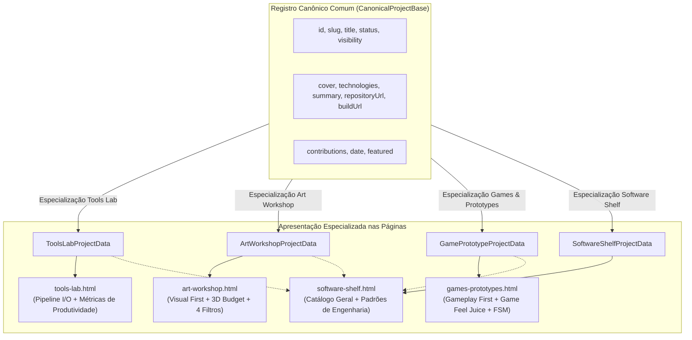

# 3 — Especificação das Estruturas de Dados de Apresentação de Projetos
## Modelagem especializada por disciplina: Tools Lab, Art Workshop, Games & Prototypes e Software Shelf

**Versão:** 1.0  
**Data:** 14 de Outubro de 2026  
**Documentos Relacionados:** 
- [`artifacts/1_cozy_developer_laboratory_engineering_spec.md`](1_cozy_developer_laboratory_engineering_spec.md)
- [`artifacts/2_portfolio_pages.md`](2_portfolio_pages.md)

---

## 1. Visão Geral e Princípios Arquiteturais

Cada tipo de projeto do Cozy Developer Laboratory possui objetivos de apresentação distintos para demonstrar profundidade de experiência e qualidade de produção:

1. **Tools Lab (`tool`):** Evidencia a eliminação de atritos e gargalos criativos, o pipeline de entrada/processamento/saída, ergonomia em extensões de editor (Custom Inspector / Scene View), segurança operacional (Undo/Redo, validação) e tempo economizado.
2. **Art Workshop (`art`):** Apresentação **Visual First** (turntables, wireframes, UV layout, clipes), categorias canônicas (`personagens`, `assets`, `animacoes`), especificações de *Technical Art Budget* (triângulos, resolução de atlas, 1 material compartilhado, poucas draw calls) e dados de rigging/animação.
3. **Games & Prototypes (`game`):** Foco em **gameplay imediato** (build jogável WebGL / vídeo em 60fps), engenharia de sensação tátil (*game feel* / *juice*: coyote time, input buffering, screen shake, squash & stretch), máquinas de estados e clareza de escopo jogável.
4. **Software Shelf (`software`):** Foco em **engenharia de software sustentável**, arquitetura limpa, padrões de projeto desacoplados (DI, Observer, Repository), métricas de teste, benchmarks de performance e distribuição semântica.

---

## 2. Diagrama Geral de Taxonomia



---

## 3. Especificação das Estruturas TypeScript

### 3.1 Base Canônica (`CanonicalProjectBase`)

```typescript
interface LocalizedString {
  pt: string;
  en: string;
}

interface CanonicalProjectBase {
  id: string;
  slug: string;
  title: string;
  projectType: "tool" | "art" | "game" | "software";
  areas: Array<"tools-lab" | "art-workshop" | "games-prototypes" | "software-shelf">;
  status: "completed" | "in-progress" | "prototype" | "archived";
  visibility: "public" | "unlisted" | "private";
  featured: boolean;
  cover: string;
  technologies: string[];
  tags: string[];
  summary: LocalizedString;
  contributions: LocalizedString;
  problem?: LocalizedString;
  solution?: LocalizedString;
  technicalDetails?: LocalizedString;
  results?: LocalizedString;
  repositoryUrl?: string | null;
  buildUrl?: string | null;
  documentationUrl?: string | null;
}
```

---

### 3.2 Tools Lab (`ToolsLabProjectData`)

```typescript
interface ToolsLabProjectData extends CanonicalProjectBase {
  projectType: "tool";
  toolClassification: 
    | "editor-extension"
    | "pipeline-automation"
    | "procedural-generator"
    | "debug-profiling"
    | "dcc-integration";

  targetEnvironment: {
    host: "Unity" | "Godot" | "Blender" | "CLI" | "Standalone";
    versionMin?: string;
    language: "C#" | "GDScript" | "Python" | "TypeScript";
  };

  workflowContext: {
    targetAudience: LocalizedString;
    painPoint: LocalizedString;
    timeSavedMetric?: string;
  };

  pipelineFlow: {
    inputs: LocalizedString[];
    processingLogic: LocalizedString;
    outputs: LocalizedString[];
  };

  technicalArchitecture: {
    dataStructures: string[];
    editorIntegrations: string[];
    safetyFeatures: LocalizedString;
  };

  evidenceMedia?: {
    demoVideoUrl?: string;
    uiScreenshots?: string[];
  };
}
```

---

### 3.3 Art Workshop (`ArtWorkshopProjectData`)

```typescript
interface ArtWorkshopProjectData extends CanonicalProjectBase {
  projectType: "art";
  mainCategory: "personagens" | "assets" | "animacoes";
  artStyle: "low-poly" | "stylized" | "hand-painted" | "pixel-art";

  technicalArtBudget: {
    triangleCount: number;
    vertexCount?: number;
    textureResolution: string;
    uvEfficiencyPercent?: number;
    materialCount: number;
    drawCallsEstimated: number;
  };

  shadingSetup?: {
    shaderType: "vertex-displacement" | "custom-lighting" | "unlit-palette" | "surface";
    techniqueSummary: LocalizedString;
    features: string[];
  };

  riggingAnimationDetails?: {
    boneCount?: number;
    hasIKControls: boolean;
    clips: Array<{
      name: string;
      frameCount: number;
      fps: number;
      looping: boolean;
    }>;
  };

  deliverableEvidence?: {
    turntableMedia?: string;
    wireframeImage?: string;
    uvLayoutImage?: string;
    inEngineScreenshot?: string;
  };
}
```

---

### 3.4 Games & Prototypes (`GamePrototypeProjectData`)

```typescript
interface GamePrototypeProjectData extends CanonicalProjectBase {
  projectType: "game";
  prototypeStage: 
    | "mechanic-prototype"
    | "game-jam"
    | "mvp"
    | "vertical-slice"
    | "completed-game";

  gameplayProfile: {
    genre: LocalizedString;
    cameraPerspective: "top-down" | "side-scroller" | "isometric" | "first-person";
    targetPlatform: string[];
    controlsSummary: LocalizedString;
  };

  gameFeelDetails: {
    movementMechanics: LocalizedString[];
    tactileFeedback: LocalizedString[];
    soundVisualSync: LocalizedString;
  };

  systemsArchitecture: {
    engineArchitecture: LocalizedString;
    dataDrivenDesign: LocalizedString;
    decouplingStrategy: LocalizedString;
  };

  playableEvidence?: {
    playableEmbedUrl?: string;
    gameplayVideoUrl?: string;
    controlsGuideImage?: string;
  };
}
```

---

### 3.5 Software Shelf (`SoftwareShelfProjectData`)

```typescript
interface SoftwareShelfProjectData extends CanonicalProjectBase {
  projectType: "software";
  softwareCategory:
    | "application"
    | "library-package"
    | "cli-utility"
    | "service-api"
    | "developer-kit";

  architectureDetails: {
    designPatterns: string[];
    modularityOverview: LocalizedString;
    dependencyPolicy: LocalizedString;
  };

  qualityAndReliability: {
    testCoveragePercentage?: number;
    testingFramework?: string;
    performanceBenchmarks?: Array<{
      metricName: string;
      measuredValue: string;
      comparisonBaseline?: string;
    }>;
  };

  distributionDetails: {
    packageManager?: string;
    license: string;
    semanticVersion: string;
  };
}
```
