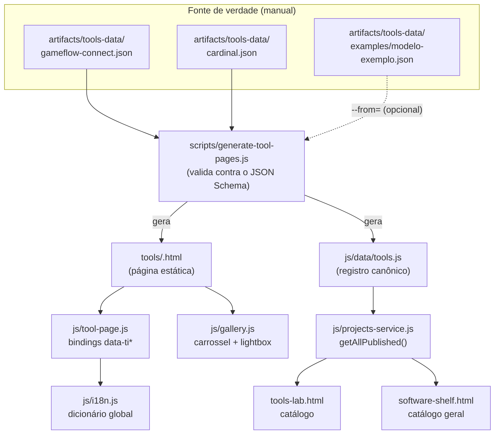

# 4 — Schema de Apresentação de Ferramentas (Tools Lab)
## Estrutura canônica, página replicável e pipeline de geração estática

**Versão:** 1.0
**Data:** 21 de Outubro de 2026
**Documentos Relacionados:**
- [`artifacts/1_cozy_developer_laboratory_engineering_spec.md`](1_cozy_developer_laboratory_engineering_spec.md)
- [`artifacts/2_portfolio_pages.md`](2_portfolio_pages.md)
- [`artifacts/3_project_presentation_schemas.md`](3_project_presentation_schemas.md)

**Estado:** Implementado. Ferramentas iniciais mapeadas: `gameflow-connect` e `cardinal`.

---

## 1. Objetivo

Definir uma estrutura **replicável** para páginas individuais de ferramentas do Tools Lab, de modo que:

1. Cada ferramenta seja documentada a partir de **um único arquivo de dados** (`artifacts/tools-data/<slug>.json`).
2. A página HTML seja **gerada estaticamente** a partir desse arquivo, com estrutura idêntica entre todas as ferramentas.
3. O conteúdo bilíngue (PT/EN) seja reativo, sem exigir regeneração da página a cada troca de idioma.
4. A adição de uma nova ferramenta **não exija alteração de código** — apenas um novo JSON e a execução do gerador.

Este documento é a contraparte de [`3_project_presentation_schemas.md`](3_project_presentation_schemas.md): enquanto o documento 3 especifica a **modelagem de dados por disciplina**, o documento 4 especifica a **montagem de uma página estática gerada** para a disciplina `tool`.

---

## 2. Análise de lacunas (motivação)

A análise do repositório em 21/10/2026 identificou os seguintes bloqueios para a produção de páginas de ferramentas:

| # | Lacuna | Consequência | Resolução neste documento |
|---|---|---|---|
| L1 | `scripts/merge-portfolio-projects.js:322` define `areas` **hardcoded** e sobrescreve `js/data/projects.js` por inteiro | Tools Lab, Art Workshop e Experiments mostravam **sempre** estado vazio; projetos adicionados à mão eram **apagados** | Pipeline separado: `artifacts/tools-data/` → `js/data/tools.js` → `js/data/projects.js` **intocado** |
| L2 | Não existia registro canônico para ferramentas | Nenhuma ferramenta podia ser catalogada | Novo diretório `artifacts/tools-data/` com schema validado |
| L3 | `project.html` é **dinâmico** (conteúdo via JS a partir de `?slug=`) | Página de ferramenta dependeria de JS para existir; sem SEO por URL própria | Páginas **estáticas** em `tools/<slug>.html`, com conteúdo embutido |
| L4 | `project.html` concentrava ~770 linhas, das quais ~150 de carrossel/lightbox inline | Duplicação inevitable a cada nova página | Módulo compartilhado `js/gallery.js` |
| L5 | Header/footer assumiam paths **relativos à raiz** | Links quebrados em subpastas (`tools/index.html` → 404) | `Components.assetRoot()` resolve a raiz relativa a partir de `location.pathname` |
| L6 | Ausência de `package.json`, CI e ordem documentada dos scripts | Pipeline não reproduzível; risco de sobrescrever arte customizada | `package.json` com `npm run generate` (ordem canônica) e `npm run check` (verificação de drift) |

---

## 3. Arquitetura do Pipeline



**Princípio de separação de pipelines.** Os jogos seguem o pipeline `artifacts/portfolio-data/` → `merge-portfolio-projects.js` → `js/data/projects.js`. As ferramentas seguem o pipeline `artifacts/tools-data/` → `generate-tool-pages.js` → `js/data/tools.js`. Os dois **nunca escrevem no mesmo arquivo**, o que elimina a sobrescrita destrutiva descrita em L1.

`js/projects-service.js` passou a agregar as duas fontes:

```js
getAllPublished() {
  const games = (typeof PROJECTS !== 'undefined' && PROJECTS) || [];
  const tools = (typeof TOOLS !== 'undefined' && TOOLS) || [];
  return [...games, ...tools].filter(p => p.visibility === 'public');
}
```

`js/data/tools.js` **não** é carregado em páginas que não precisam dele, mas o acesso é defensivo (`typeof TOOLS !== 'undefined'`), o que mantém a compatibilidade com qualquer página que carregue apenas `projects.js`.

---

## 4. Schema Canônico — `ToolPageRecord`

Cada ferramenta é descrita por um arquivo `artifacts/tools-data/<slug>.json`. O schema completo e validável está em [`artifacts/tools-data/tool-page.schema.json`](tools-data/tool-page.schema.json) (JSON Schema draft 2020-12).

### 4.1 Identidade e classificação

| Campo | Tipo | Obrigatório | Descrição |
|---|---|:---:|---|
| `id` | `string` (kebab-case) | ✅ | Identificador estável. Deve ser igual ao `slug`. |
| `slug` | `string` (kebab-case) | ✅ | Define o nome do arquivo gerado (`tools/<slug>.html`). |
| `title` | `Localized` | ✅ | Nome da ferramenta. |
| `subtitle` | `Localized` | — | Linha de apoio exibida abaixo do título. |
| `icon` | `string` (≤ 8 chars) | — | Emoji exibido no cabeçalho e na capa. |
| `accent` | `green\|orange\|blue\|purple\|slate` | — | Define a cor de destaque da página. |
| `projectType` | `"tool"` (fixo) | ✅ | Discrimina a disciplina. |
| `status` | `completed\|in-progress\|prototype\|archived` | ✅ | Estado real do trabalho. |
| `visibility` | `public\|draft\|private` | ✅ | Controle de exposição. |
| `featured` | `boolean` | — | Destaque na home. |
| `collaborationType` | `portfolio\|parceria\|comercial\|estudo` | — | Natureza do projeto (badge). |
| `partner` | `string\|null` | — | Nome da equipe, marca ou empresa parceira. |
| `tags` | `string[]` | — | Tags de busca. |
| `technologies` | `string[]` | — | Linguagem, engine, APIs. |
| `toolClassification` | `editor-extension\|pipeline-automation\|procedural-generator\|debug-profiling\|dcc-integration\|cli-utility` | — | Categoria técnica exibida como badge. |
| `host` | `{name, version?, language?}` | — | Ambiente alvo. |

### 4.2 Conteúdo narrativo

| Campo | Tipo | Obrigatório | Seção na página |
|---|---|:---:|---|
| `summary` | `Localized` | ✅ | Lead do pitch |
| `problem` | `Localized` | ✅ | "Gargalo Operacional" |
| `solution` | `Localized` | ✅ | "Abordagem Técnica & Solução" |
| `contributions` | `Localized` | ✅ | "Responsabilidades & Contribuição Individual" |
| `results` | `Localized` | ✅ | "Resultados & Limitações Observadas" |

### 4.3 Contexto de workflow e impacto

```jsonc
"workflowContext": {
  "targetAudience": { "pt": "...", "en": "..." },
  "painPoint":       { "pt": "...", "en": "..." },
  "timeSavedMetric": "~40 min por iteração",   // string | null
  "metrics": [                                // métricas complementares
    { "label": { "pt": "...", "en": "..." }, "value": "18", "hint": { "pt": "...", "en": "..." } }
  ]
}
```

`timeSavedMetric` é opcional e **não deve ser inventado**. Se a ferramenta não tem métrica medida, use `null` — a página omite o card correspondente.

### 4.4 Recursos

```jsonc
"features": [
  { "icon": "🕸️", "title": { "pt": "...", "en": "..." }, "body": { "pt": "...", "en": "..." } }
]
```

Seções com array vazio são **omitidas** da página gerada.

### 4.5 Pipeline (I/O)

```jsonc
"pipelineFlow": {
  "inputs":  [ { "pt": "...", "en": "..." } ],
  "processingLogic": { "pt": "...", "en": "..." },
  "outputs": [ { "pt": "...", "en": "..." } ]
}
```

Alinhado à seção 3 de [`2_portfolio_pages.md`](2_portfolio_pages.md): *"Entrada, processamento e saída"*.

### 4.6 Arquitetura técnica

```jsonc
"technicalArchitecture": {
  "designDecisions": [ { "title": { "pt": "...", "en": "..." }, "body": { "pt": "...", "en": "..." } } ],
  "dataStructures":   [ "Immutable Graph", "RuleSet" ],
  "editorIntegrations":[ "Unity EditorWindow", "CLI Runner (CI)" ]
}
```

`designDecisions` é a adição em relação ao schema 3 (§3.2), que não previa registrar o *porquê* das decisões. É o campo que distingue um relatório de engenharia de uma lista de funcionalidades.

### 4.7 Validação e segurança

```jsonc
"validation": {
  "safetyFeatures": { "pt": "...", "en": "..." },
  "testCoverage": "86%",                  // string | null
  "checks": [ { "title": { "pt": "...", "en": "..." }, "body": { "pt": "...", "en": "..." } } ]
}
```

Alinhado à seção 3 de [`2_portfolio_pages.md`](2_portfolio_pages.md): *"Validações, testes e tratamento de erros"*.

### 4.8 Mídia, resultados e links

```jsonc
"gallery": [
  { "src": "assets/tools/<slug>/gallery-01.svg",
    "caption": { "pt": "...", "en": "..." },
    "alt": "Descrição acessível da imagem" }
],
"limitations": [ { "pt": "...", "en": "..." } ],
"nextSteps":   [ { "pt": "...", "en": "..." } ],
"links": {
  "repositoryUrl":   "https://github.com/..." | null,
  "buildUrl":        null,
  "documentationUrl": null,
  "demoUrl":         null
}
```

**Caminhos de mídia são relativos à raiz do site** (`assets/tools/...`), nunca relativos à página. O gerador converte para relativo à subpasta (`../assets/...`) na saída HTML, e o runtime (`js/tool-page.js`) faz a mesma conversão para a galeria montada por JS.

Links `null` são **omitidos** — o botão correspondente não é renderizado. Isso evita botões quebrados.

### 4.9 Tipo `Localized`

Aceita duas formas:

```jsonc
"summary": "Texto único (não traduzido)"
"summary": { "pt": "Texto em português", "en": "English text" }
```

A resolução segue a ordem: `valor[idioma_ativo]` → `valor.pt` → `valor.en` → string vazia. Textos simples são usados quando a ferramenta não tem tradução registrada.

---

## 5. Estrutura da Página Gerada

A ordem das seções é fixa e deriva da ordem visual comum da seção 8 de [`2_portfolio_pages.md`](2_portfolio_pages.md), adaptada à natureza de uma ferramenta.

| # | Bloco | Classe CSS | Origem dos dados | Condicional |
|---|---|---|---|---|
| 0 | Breadcrumb | `.tool-breadcrumb` | `title` | sempre |
| 1 | Cabeçalho (título, subtítulo, badges) | `.tool-page-header` | `title`, `subtitle`, `status`, `collaborationType`, `partner`, `toolClassification`, `host`, `technologies` | sempre |
| 2 | Capa / demonstração | `.tool-page-hero` | `cover` | se `cover` |
| 3 | Pitch: resumo + problema + solução | `.tool-section-pitch` | `summary`, `problem`, `solution` | sempre |
| 4 | Contexto de workflow e impacto | `.tool-section-workflow` | `workflowContext.*` | sempre |
| 5 | Recursos principais | `.tool-section-features` | `features[]` | se `features[]` |
| 6 | Pipeline (I/O) | `.tool-section-pipeline` | `pipelineFlow.*` | sempre |
| 7 | Galeria / capturas de interface | `.tool-section-gallery` | `gallery[]` | se `gallery[]` |
| 8 | Arquitetura técnica | `.tool-section-architecture` | `technicalArchitecture.*` | sempre |
| 9 | Validação e testes | `.tool-section-validation` | `validation.*` | sempre |
| 10 | Resultados, limitações, próximos passos | `.tool-section-results` | `results`, `limitations[]`, `nextSteps[]` | sempre |
| 11 | Contribuição individual | `.tool-section-contributions` | `contributions` | sempre |
| 12 | Links e recursos | `.case-study-actions` | `links.*` | sempre |
| — | Lightbox (modal) | `.lightbox-modal` | — | sempre (inativo) |

### 5.1 Por que esta ordem

- **Mídia antes do texto** (blocos 2 e 7): a seção 2 de [`2_portfolio_pages.md`](2_portfolio_pages.md) define a apresentação *Visual First* — o resultado antes do processo.
- **Problema → solução → impacto** (blocos 3 e 4): o leitor entende a dor, o mecanismo e o ganho antes do detalhe de implementação.
- **Pipeline antes da arquitetura** (blocos 6 e 8): o fluxo funcional precede a implementação; é o que interessa a quem não é da área.
- **Validação antes dos resultados** (blocos 9 e 10): a credibilidade do resultado depende das garantias descritas imediatamente antes.
- **Contribuição individual por último** (bloco 11): em projetos colaborativos, a atribuição é a informação que o leitor busca ao final da leitura.

### 5.2 Layout interno

| Bloco | Estrutura visual |
|---|---|
| 4 — Workflow | Grade de até 3 cards: público-alvo (texto), impacto (`timeSavedMetric`, destaque) e métricas complementares |
| 5 — Recursos | Grade `auto-fit minmax(260px, 1fr)` de cards com ícone, título e descrição |
| 6 — Pipeline | Três colunas (Entradas · Processamento · Saídas) separadas por setas; empilha verticalmente abaixo de 900px |
| 8 — Arquitetura | Grupos de tags (estruturas, integrações) + grade de decisões técnicas |
| 9 — Validação | Card de cobertura de testes (destaque) + callout de segurança + grade de verificações |
| 10 — Resultados | Parágrafo + duas colunas (limitações / próximos passos) |

---

## 6. Contrato do Template

### 6.1 Templates e bindings

O template vive em [`scripts/templates/tool-page.template.js`](../scripts/templates/tool-page.template.js). Toda página gerada passa por `renderToolPage(tool, options)`.

A página usa **dois sistemas de binding**, com responsabilidades disjuntas:

| Binding | Fonte | Escopo | Uso |
|---|---|---|---|
| `data-i18n="chave"` | Dicionário global `js/i18n.js` | Rótulos da interface | Títulos de seção, botões, rótulos genéricos |
| `data-ti="caminho"` | JSON embutido da página | Conteúdo da ferramenta | Textos específicos do projeto |
| `data-ti-html="caminho"` | JSON embutido | Conteúdo da ferramenta | Texto com marcação permitida (`<code>`, `<strong>`) |
| `data-ti-list="caminho"` | JSON embutido | Conteúdo da ferramenta | Array → um `<li>` por item |
| `data-ti-alt="caminho"` | JSON embutido | Conteúdo da ferramenta | Atributo `alt` |

Caminhos são **dot-paths** sobre o registro canônico:

```
summary
workflowContext.painPoint
workflowContext.metrics.0.label
technicalArchitecture.designDecisions.0.title
pipelineFlow.inputs
```

### 6.2 Estratégia de internacionalização

A página é gerada com o conteúdo em **PT** já embutido no HTML — o que garante indexação por buscadores e funcionamento sem JavaScript. Ao trocar o idioma, `js/tool-page.js` re-resolve os bindings `data-ti*` **sem recarregar a página**, lendo o JSON canônico completo embutido em:

```html
<script type="application/json" id="tool-data">{ ...registro completo... }</script>
```

Os rótulos globais continuam sendo resolvidos por `t()` do dicionário estático. Consequência prática: **trocar de idioma não exige regenerar o HTML**.

Chaves de i18n adicionadas em v0.17.0 (PT/EN): `toolClassEditorExtension`, `toolClassPipelineAutomation`, `toolClassProceduralGenerator`, `toolClassDebugProfiling`, `toolClassDccIntegration`, `toolClassCliUtility`, `toolFeaturesTitle`, `toolArchitectureDecisionsTitle`, `toolValidationTitle`, `toolTestCoverage`, `toolLimitationsTitle`, `toolNextStepsTitle`, `toolViewDetails`, `btnDocumentation`, `btnDemo`.

### 6.3 Módulos de runtime

| Arquivo | Responsabilidade |
|---|---|
| `js/gallery.js` | Carrossel + lightbox, reutilizável. Extraído da implementação de `project.html` e parametrizado com `resolveSrc` para suportar subpastas. |
| `js/tool-page.js` | Lê `#tool-data`, aplica os bindings `data-ti*`, monta a galeria, atualiza `<title>` e `<meta description>` na troca de idioma. |
| `js/components.js` | Header/footer com `assetRoot()`; cards com suporte a `pageUrl`. |
| `js/projects-service.js` | Agrega `PROJECTS` + `TOOLS`. |

`project.html` **ainda mantém** sua cópia inline do carrossel. A migração para `js/gallery.js` é um follow-up de baixo risco (ver seção 11).

---

## 7. Pipeline de Geração

### 7.1 Comandos

```bash
npm install          # não instala nada (zero dependências) — apenas habilita os scripts
npm run serve        # servidor local em http://localhost:8080
npm run generate     # pipeline completo, na ordem canônica
npm run check        # verifica se os artefatos gerados estão em dia (CI)
```

Scripts individuais:

```bash
npm run generate:tool-assets   # capas e miniaturas placeholder em assets/tools/
npm run generate:tools         # tools/<slug>.html + js/data/tools.js
npm run generate:tool-example  # gera tools/modelo-exemplo.html a partir do exemplo
```

Opções diretas do gerador:

```bash
node scripts/generate-tool-pages.js --slug=cardinal       # regenera uma ferramenta
node scripts/generate-tool-pages.js --from=<caminho.json>  # renderiza um rascunho isolado
node scripts/generate-tool-pages.js --check                # modo CI (falha se houver drift)
```

### 7.2 Ordem canônica

`npm run generate` executa nesta ordem, e a ordem é **significativa**:

```
generate:projects   →  merge-portfolio-projects.js   (jogos)
generate:assets     →  generate-assets.js            (placeholders dos jogos)
generate:covers     →  generate-custom-covers.js      (capas ilustradas dos jogos)
generate:tool-assets→  generate-tool-covers.js       (placeholders das ferramentas)
generate:tools      →  generate-tool-pages.js        (páginas + js/data/tools.js)
```

`generate-assets.js` e `generate-custom-covers.js` escrevem no **mesmo** caminho (`assets/projects/<slug>/cover.svg`). A ordem `assets` → `covers` é obrigatória: invertê-la sobrescreve as capas ilustradas com placeholders. Essa constraint agora está registrada no `package.json` e neste documento.

`generate-tool-covers.js` **preserva** arquivos existentes por padrão (protege arte customizada) e só sobrescreve com `--force`.

### 7.3 Saídas geradas

| Arquivo | Gerado por | Versionado |
|---|---|:---:|
| `tools/<slug>.html` | `generate-tool-pages.js` | ✅ sim |
| `js/data/tools.js` | `generate-tool-pages.js` | ✅ sim |
| `assets/tools/<slug>/*.svg` | `generate-tool-covers.js` | ✅ sim |

Os arquivos gerados são versionados no repositório porque o site é **100% estático** e o GitHub Pages não executa build. A verificação de drift (`npm run check`) garante que o versionado corresponde à fonte.

---

## 8. Como Adicionar uma Nova Ferramenta

1. **Crie o registro:**
   ```bash
   # copie o exemplo de referência
   cp artifacts/tools-data/examples/modelo-exemplo.json artifacts/tools-data/minha-ferramenta.json
   ```
2. **Edite o JSON** adjusting `id`, `slug`, `title`, `icon`, `accent` e o conteúdo. O nome do arquivo **deve** ser `<slug>.json` — o gerador valida essa correspondência.
3. **Valide e gere:**
   ```bash
   npm run generate:tools
   ```
   Se o JSON violar o schema, o gerador **falha com a lista de erros** e não escreve nada:
   ```
   ❌ Validação falhou em 1 arquivo(s):

   minha-ferramenta.json:
       - $.technologies[0]: esperado tipo "string", recebido "number"
       - $.slug: "minha-ferramenta" não corresponde ao padrão ^[a-z0-9]+(?:-[a-z0-9]+)*$
   ```
4. **Gere os assets** (capa e miniaturas placeholder):
   ```bash
   npm run generate:tool-assets
   ```
   Substitua os placeholders por capturas reais em `assets/tools/<slug>/`.
5. **Verifique localmente:**
   ```bash
   npm run serve
   # abrir http://localhost:8080/tools/minha-ferramenta.html
   ```
6. **Publique.** A ferramenta aparece automaticamente em `tools-lab.html` e `software-shelf.html` (via `getByArea('tools-lab')` e `getByArea('software-shelf')`), e o card aponta para a página estática.

**Nenhuma alteração de código é necessária** — apenas o JSON, os assets e a execução do gerador.

---

## 9. Validação

O gerador valida cada registro contra [`artifacts/tools-data/tool-page.schema.json`](tools-data/tool-page.schema.json) antes de escrever qualquer arquivo. O subconjunto de JSON Schema suportado pelo validador (`scripts/generate-tool-pages.js`):

| Keyword | Comportamento |
|---|---|
| `type` | Verificação de tipo, com suporte a unions (`["string", "null"]`) |
| `required` | Campos obrigatórios ausentes são reportados |
| `properties` / `additionalProperties: false` | Campos desconhecidos são reportados (detecta erros de digitação) |
| `items` | Validação de cada elemento de array |
| `enum` / `const` | Valores fora do conjunto permitido |
| `pattern` | Formato de `id`, `slug` e `icon` |
| `oneOf` + `$defs` | Tipo `Localized` (string **ou** objeto `{pt, en}`) |
| `minLength` / `maxLength` | Limites de tamanho |

Regras adicionais do gerador:

- O **nome do arquivo** deve ser `<slug>.json`.
- A **validação é bloqueante**: um registro inválido impede a geração de *qualquer* artefato, evitando estado parcial no repositório.
- `additionalProperties: false` garante que uma chave grafada incorretamente (ex.: `techologies`) seja reportada em vez de silenciosamente ignorada.

---

## 10. Acessibilidade e SEO

Garantias verificadas na página gerada:

| Aspecto | Implementação |
|---|---|
| Estrutura | `<header>` → `<article>` → `<figure>` → `<section>` com `h1` único e `h2` por seção |
| Navegação | Breadcrumb com `aria-current="page"` |
| Galeria | `aria-roledescription="carousel"`, `role="region"`, `aria-current` nos dots/miniaturas, navegação por `ArrowLeft`/`ArrowRight` |
| Lightbox | `role="dialog"`, `aria-modal="true"`, `aria-hidden` alternado, `Escape` fecha, foco move-se para o botão de fechar e retorna à origem |
| Mídia | `alt` obrigatório em todas as imagens; `loading="lazy"` nas miniaturas |
| Contraste | Paleta de acentos por `accent` com variantes claras (`--tool-accent-text`) sobre fundos escuros |
| Movimento | `prefers-reduced-motion: reduce` neutraliza transições globalmente (`css/style.css:41-48`) |
| Responsivo | 3 breakpoints: 900px (pipeline empilha), 768px e 640px (base do `style.css`) |
| SEO | `<title>`, `<meta description>` (≤ 160 chars), `og:title`, `og:description`, `og:image`, `<link rel="canonical">` |
| Sem JS | Todo o conteúdo textual está no HTML gerado; apenas a troca de idioma e a galeria dependem de JS |

---

## 11. Decisões em Aberto

| # | Questão | Impacto | Recomendação atual |
|---|---|---|---|
| D1 | `project.html` mantém uma cópia inline do carrossel | ~150 linhas duplicadas | Migrar para `js/gallery.js` (módulo já testado nesta entrega) |
| D2 | `js/data/tools.js` e `js/data/projects.js` são carregados por `<script>` clássico | Sem cache por hash | Migrar ambos para módulos ES quando o restante do site migrar |
| D3 | A página de ferramenta não tem um "estudo de caso" dinâmico equivalente | Dois modelos de apresentação de projeto | Aceitável: a página estática é a forma canônica para `projectType: "tool"`; `project.html` redireciona para ela |
| D4 | Subpasta `tools/` vs. arquivos na raiz | Caminhos relativos extras | Manter `tools/`: URLs limpas, escala e isolamento de assets |
| D5 | Sem CI no GitHub Actions | Drift de artefatos gerados | Adicionar workflow que rode `npm run check` em cada push |
| D6 | Ausência de `.nojekyll` no repositório | GitHub Pages executava Jekyll | **Resolvido** em v0.17.0 — `.nojekyll` adicionado |
| D7 | Conteúdo das duas ferramentas mapeado a partir da narrativa do autor | Métricas e links públicos ainda pendentes | Preencher `timeSavedMetric`, `testCoverage` e `links.repositoryUrl` com dados verificados antes de publicar (ver seção 12) |

---

## 12. Checklist de Publicação de uma Ferramenta

### 12.1 Separação entre narrativa e verificação

O preenchimento de um registro mistura duas naturezas de informação, e elas **não** devem ser tratadas com o mesmo rigor:

| Tipo de campo | Exemplo | Regra |
|---|---|---|
| **Narrativa** | `summary`, `problem`, `solution`, `contributions`, `features`, `designDecisions` | Derivada da descrição do autor. Revisar a precisão técnica, mas não exige medição. |
| **Verificação** | `timeSavedMetric`, `testCoverage`, `links.*`, `gallery` | Exige dado real ou link testável. Ausente → `null` ou array vazio. **Nunca inventar.** |

A regra estrutural do schema garante que a ausência seja visível e não enganosa: um `timeSavedMetric: null` **omite o card** em vez de exibir "0 min" ou um valor inventado, e um `repositoryUrl: null` **não gera botão** em vez de quebrar.

### 12.2 Checklist

Antes de considerar uma página de ferramenta pronta para publicação:

- [ ] `slug` e `id` correspondem e são kebab-case
- [ ] `title`, `summary`, `problem`, `solution`, `contributions`, `results` preenchidos em PT **e** EN
- [ ] `status` reflete o estado real (não "completed" para trabalho em andamento)
- [ ] `technologies` lista apenas tecnologias realmente usadas
- [ ] `workflowContext.timeSavedMetric` é uma métrica **medida** (ou `null`)
- [ ] `validation.testCoverage` reflete a cobertura real (ou `null`)
- [ ] `gallery` com **ao menos 2** imagens reais, com `alt` descritivo
- [ ] `links` contém apenas URLs verificadas e acessíveis
- [ ] `limitations` lista limitações reais — não omite pontos fracos
- [ ] Capa em `assets/tools/<slug>/cover.svg` é arte própria (não placeholder)
- [ ] `npm run check` passa sem drift
- [ ] Verificado em PT e EN, e em viewport móvel (≤ 640px)
- [ ] Revisão de confidencialidade e direitos de uso das mídias

---

## 13. Critérios de Aceite

- ✅ Existe um único registro canônico por ferramenta, em `artifacts/tools-data/`.
- ✅ O registro é validado contra um JSON Schema antes da geração.
- ✅ A página HTML é gerada estaticamente, com estrutura idêntica entre ferramentas.
- ✅ A troca de idioma é reativa, sem regenerar o HTML.
- ✅ O pipeline de ferramentas **não interfere** no pipeline de jogos.
- ✅ Uma nova ferramenta é adicionada sem alteração de código.
- ✅ Links externos ausentes não geram botões quebrados.
- ✅ Seções sem dados são omitidas, não exibidas vazias.
- ✅ Todas as páginas geradas passam nos checks de acessibilidade e responsividade.
