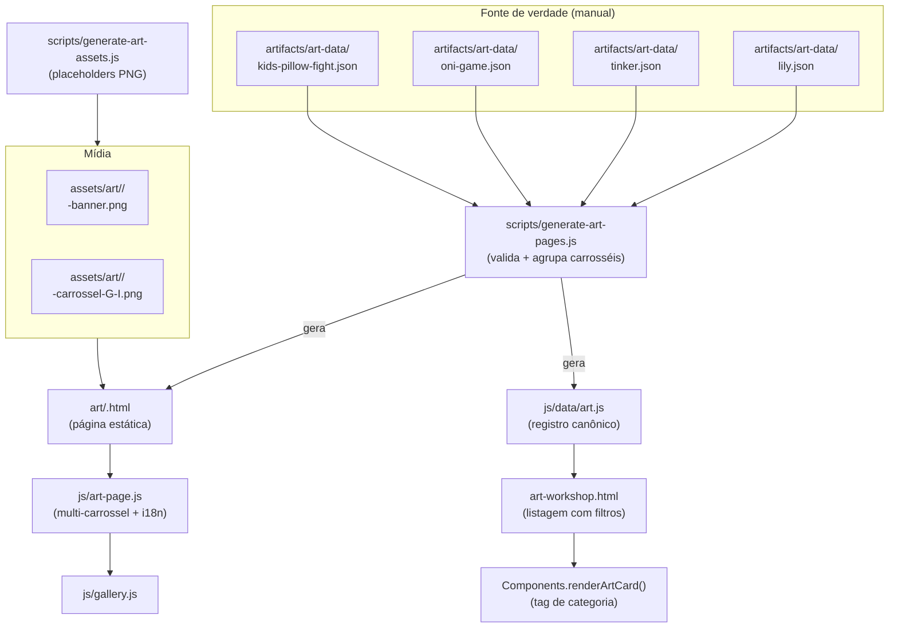

# 5 — Schema de Apresentação de Arte (Art Workshop)
## Categorias, tag visual, apresentação principal e múltiplos carrosséis

**Versão:** 1.0
**Data:** 21 de Outubro de 2026
**Documentos Relacionados:**
- [`artifacts/1_cozy_developer_laboratory_engineering_spec.md`](1_cozy_developer_laboratory_engineering_spec.md)
- [`artifacts/2_portfolio_pages.md`](2_portfolio_pages.md)
- [`artifacts/3_project_presentation_schemas.md`](3_project_presentation_schemas.md)
- [`artifacts/4_tools_lab_page_schema.md`](4_tools_lab_page_schema.md)

**Estado:** Implementado. Trabalhos iniciais mapeados: `lily`, `tinker`, `oni-game`, `kids-pillow-fight`.

---

## 1. Objetivo

Definir a estrutura do **Art Workshop** — a área que apresenta os trabalhos de modelagem 3D — com quatro requisitos centrais:

1. **Categorias principais explícitas:** `personagens`, `assets` e `animacoes`, com **tag visual obrigatória** na listagem.
2. **Apresentação principal:** vídeo principal **ou** imagem de banner, conforme o que estiver disponível para cada trabalho.
3. **Carrossel de imagens** com legendas e descrições de características **concisas**.
4. **Múltiplos carrosséis por projeto**, deduzidos da convenção de nomes dos arquivos.

Este documento é a contraparte de [`4_tools_lab_page_schema.md`](4_tools_lab_page_schema.md) para a disciplina `art`.

---

## 2. Arquitetura do Pipeline



**Separação de pipelines.** Cada disciplina tem sua própria fonte de verdade e seu próprio gerador, nunca escrevendo no mesmo arquivo:

| Disciplina | Fonte | Gerador | Saída canônica | Páginas |
|---|---|---|---|---|
| Jogos | `artifacts/portfolio-data/` | `merge-portfolio-projects.js` | `js/data/projects.js` | `project.html?slug=` |
| Ferramentas | `artifacts/tools-data/` | `generate-tool-pages.js` | `js/data/tools.js` | `tools/<slug>.html` |
| **Arte** | `artifacts/art-data/` | `generate-art-pages.js` | `js/data/art.js` | `art/<slug>.html` |

`js/projects-service.js` agrega as três fontes em `getAllPublished()` e mantém `getArtWorks()` / `getByArtCategory()` com semântica própria do Art Workshop.

---

## 3. Categorias e Tag Visual

### 3.1 Taxonomia

| `mainCategory` | Rótulo PT | Rótulo EN | Ícone | Acento |
|---|---|---|---|---|
| `personagens` | Personagem | Character | 🎭 | Roxo (`#c084fc`) |
| `assets` | Asset | Asset | 🗿 | Verde (`#34d399`) |
| `animacoes` | Animação | Animation | 🎬 | Laranja (`#fb923c`) |

A taxonomia está em [`js/data/art-categories.js`](../js/data/art-categories.js) — fonte única consumed pelo template (Node), pelo card da listagem (browser) e pelos filtros.

### 3.2 Tag visual

A tag é um elemento **sempre presente** no card da listagem e no cabeçalho da página:

```html
<span class="art-category-tag art-category-tag--green art-card-tag">
  <span class="art-category-tag-icon" aria-hidden="true">🗿</span>
  <span>Asset</span>
</span>
```

Propriedades:

- **Cor por categoria** — a cor de acento é herdada do token `--cat-color`, com fundo translúcido via `color-mix`.
- **Ícone + rótulo textual** — a categoria nunca é comunicada apenas por cor (acessibilidade).
- **Posicionamento** — no card, no canto superior esquerdo da mídia; na página, ao lado do título.
- **Texto localizado** — o rótulo vem do dicionário i18n (`artCategoryCharacters`, `artCategoryAssets`, `artCategoryAnimations`).

### 3.3 Regras de classificação

Herdadas da §4.1 de [`2_portfolio_pages.md`](2_portfolio_pages.md):

- Cada trabalho tem **uma** categoria principal.
- Tags secundárias permitem que um trabalho também apareça em outro filtro.
- A filtragem usa o registro canônico, nunca o nome do arquivo ou o texto descritivo.

---

## 4. Schema Canônico — `ArtWorkRecord`

Cada trabalho é descrito por `artifacts/art-data/<slug>.json`. Schema validável em [`artifacts/art-data/art-page.schema.json`](art-data/art-page.schema.json).

### 4.1 Identidade e classificação

| Campo | Tipo | Obrigatório | Descrição |
|---|---|:---:|---|
| `id` | `string` (kebab-case) | ✅ | Identificador estável. |
| `slug` | `string` (kebab-case) | ✅ | Define `art/<slug>.html` e o prefixo dos arquivos de mídia. |
| `title` | `Localized` | ✅ | Nome do trabalho. |
| `subtitle` | `Localized` | — | Linha de apoio. |
| `icon` | `string` | — | Emoji. |
| `accent` | `green\|orange\|blue\|purple\|slate\|rose` | — | Cor de destaque da página. |
| `mainCategory` | `personagens\|assets\|animacoes` | ✅ | Categoria principal. |
| `tags` | `string[]` | — | Tags secundárias (permitem filtro cruzado). |
| `technologies` | `string[]` | — | Ferramentas usadas. |
| `status` | `completed\|in-progress\|prototype\|archived` | ✅ | Estado real. |
| `visibility` | `public\|draft\|private` | ✅ | Controle de exposição. |
| `featured` | `boolean` | — | Destaque na home. |
| `cover_pic` | `string` | — | Imagem usada no card da listagem. |

### 4.2 Apresentação principal

```jsonc
"banner": {
  "src": "assets/art/lily/lily-banner.png",   // relativo à raiz do site
  "alt": "Lily the Ebony Tusk Chieftain",
  "caption": { "pt": "...", "en": "..." }
},
"video": {
  "src": "assets/art/lily/lily-turntable.mp4",
  "poster": "assets/art/lily/lily-banner.png",
  "caption": { "pt": "...", "en": "..." },
  "loop": true,     // padrão: true
  "muted": true,    // padrão: true
  "controls": false // padrão: false (autoplay)
}
```

**Precedência:** se `video.src` existir, o vídeo é a apresentação principal; o `banner` é usado como `poster` e como **fallback**.

**Fallback automático:** `js/art-page.js` escuta o evento `error` do elemento `<video>` e substitui o vídeo pela imagem de banner, convertendo o container para `.art-hero--image`. Uma página nunca fica com um player quebrado.

### 4.3 Características (concisas)

```jsonc
"characteristics": [
  { "label": { "pt": "Polígonos", "en": "Triangles" }, "value": { "pt": "≈ 4.200 tri", "en": "≈ 4.2k tris" } },
  { "label": { "pt": "Texturas", "en": "Textures" }, "value": { "pt": "1024² atlas", "en": "1024² atlas" } }
]
```

Regras:

- São **etiqueta + valor**, nunca parágrafos.
- O schema exige **ao menos 1** característica (`minItems: 1`).
- A listagem mostra **no máximo 3**; a página mostra todas.
- Rótulos sugeridos por categoria:

| Categoria | Características sugeridas |
|---|---|
| `personagens` | Estilo · Polígonos · Texturas · Materiais · Ossos |
| `assets` | Tipo · Polígonos · Texturas · Materiais · Draw Calls |
| `animacoes` | Duração · FPS · Loop · Clipes · Rig |

### 4.4 Mídia e múltiplos carrosséis

```jsonc
"media": [
  { "src": "assets/art/lily/lily-carrossel-1-1.png", "caption": { "pt": "...", "en": "..." }, "alt": "..." },
  { "src": "assets/art/lily/lily-carrossel-1-2.png", "caption": { "pt": "...", "en": "..." }, "alt": "..." },
  { "src": "assets/art/lily/lily-carrossel-2-1.png", "caption": { "pt": "...", "en": "..." }, "alt": "..." }
]
```

**Convenção de nomes.** O agrupamento em carrosséis é **deduzido do nome do arquivo**, sem configuração adicional:

```
<slug>-carrossel-<grupo>-<item>.<ext>

lily-carrossel-1-1.png   → carrossel 1, item 1
lily-carrossel-1-2.png   → carrossel 1, item 2
lily-carrossel-2-1.png   → carrossel 2, item 1
```

- O regex de reconhecimento é `carrossel[-_](\d+)[-_](\d+)` (case-insensitive).
- Arquivos **sem** o padrão caem em um **único** carrossel, preservando a ordem de declaração.
- O campo opcional `carousel` (inteiro) **força** o grupo, útil quando o nome do arquivo não segue a convenção.
- A ordenação dentro de um grupo é pelo número do item, não pela ordem de declaração.

**Na página**, quando há mais de um carrossel, aparece uma **aba por carrossel** (`Carrossel 1`, `Carrossel 2`) acima do palco. A troca preserva o estado (dots, miniatura ativa, legenda) e é acessível por teclado.

### 4.5 Conteúdo narrativo

| Campo | Tipo | Seção |
|---|---|---|
| `summary` | `Localized` | Resumo (curto) |
| `process` | `Localized` | Processo realizado |
| `integration` | `Localized` | Integração na engine |
| `limitations` | `Localized[]` | Limitações |
| `links` | objeto | Repositório, build, documentação, demo |

---

## 5. Estrutura da Página Gerada

| # | Bloco | Classe | Origem | Condicional |
|---|---|---|---|---|
| 0 | Breadcrumb | `.art-breadcrumb` | `title` | sempre |
| 1 | Cabeçalho (título, **tag de categoria**, status, tags) | `.art-page-header` | `title`, `mainCategory`, `status`, `tags`, `technologies` | sempre |
| 2 | Apresentação principal (vídeo **ou** banner) | `.art-hero` | `video` / `banner` | se houver mídia |
| 3 | Características | `.art-section-characteristics` | `characteristics[]` | sempre (mín. 1) |
| 4 | Galeria / carrossel(is) | `.art-section-gallery` | `media[]` | se houver mídia |
| 5 | Resumo | `.art-section-summary` | `summary` | sempre |
| 6 | Processo e integração | `.art-section-process` | `process`, `integration` | se houver |
| 7 | Links | `.case-study-actions` | `links.*` | sempre |

### 5.1 Ordem visual

A §4.3 de [`2_portfolio_pages.md`](2_portfolio_pages.md) define a ordem do Art Workshop: *"A ordem varia conforme o foco, mantendo a apresentação visual em primeiro lugar"*. A ordem adotada aqui é:

**Mídia → Características → Galeria → Resumo → Processo**

Rationale: quem chega pelo portfólio quer **ver** o trabalho antes de ler sobre ele. As características vêm logo após a mídia porque são a leitura mais rápida das especificações técnicas (polycount, texturas, duração). O resumo e o processo ficam depois, para quem quiser o contexto completo.

### 5.2 A listagem — `art-workshop.html`

A listagem é renderizada por `Components.renderArtCard()` e apresenta, por trabalho:

| Elemento | Classe | Descrição |
|---|---|---|
| Mídia | `.art-card-media` | Banner em imagem, ou `<video>` quando há vídeo principal. |
| **Tag de categoria** | `.art-card-tag` | Sobreposta à mídia, canto superior esquerdo, com cor por categoria. |
| Selo de vídeo | `.art-card-video-badge` | Canto inferior direito, apenas quando há vídeo. |
| Título | `.art-card-title` | — |
| Resumo | `.art-card-summary` | 3 linhas com `-webkit-line-clamp`. |
| Especificações | `.art-card-specs` | Até 3 características, `label` + `value`. |
| Ação | `.art-card-footer` | Botão para `art/<slug>.html`. |

Os **filtros** (`Todos`, `Personagens`, `Assets`, `Animações`) operates sobre `ProjectsService.getByArtCategory()`, refletem o estado na URL (`?category=`) e são compartilháveis.

---

## 6. Geração de Mídia Placeholder

`scripts/generate-art-assets.js` produz as imagens de banner e de carrossel como **PNG reais** (1200×675, RGB), usando um codificador PNG próprio em [`scripts/lib/png.js`](../scripts/lib/png.js) — `zlib` nativo do Node, zero dependências.

Cada placeholder é visualmente distinto por categoria (símbolo central: silhueta para personagens, losango para assets, triângulo para animações) e traz o **rótulo `G-I`** (grupo-item) no canto superior esquerdo, o que permite conferir visualmente se o agrupamento em carrosséis está correto.

Comportamento: arquivos existentes são **preservados** (protege arte final); `--force` sobrescreve.

---

## 7. Como Adicionar um Novo Trabalho

1. **Crie o registro** em `artifacts/art-data/<slug>.json`:
   ```bash
   cp artifacts/art-data/lily.json artifacts/art-data/meu-trabalho.json
   ```
2. **Edite o JSON**: `id`, `slug`, `title`, `mainCategory`, `icon`, `accent` e o conteúdo.
3. **Prepare a mídia** com a convenção de nomes:
   ```
   assets/art/meu-trabalho/meu-trabalho-banner.png
   assets/art/meu-trabalho/meu-trabalho-carrossel-1-1.png
   assets/art/meu-trabalho/meu-trabalho-carrossel-1-2.png
   assets/art/meu-trabalho/meu-trabalho-carrossel-2-1.png   (opcional)
   ```
4. **Gere**:
   ```bash
   npm run generate:art-assets   # placeholders (só se a arte final ainda não existir)
   npm run generate:art          # páginas + js/data/art.js
   ```
5. **Verifique**:
   ```bash
   npm run serve
   # http://localhost:8080/art/meu-trabalho.html
   ```

Nenhuma alteração de código é necessária.

---

## 8. Validação

O gerador valida contra o JSON Schema **antes** de escrever qualquer arquivo. A validação é **bloqueante** — um registro inválido impede a geração de todos os artefatos, evitando estado parcial.

Keywords suportadas (implementadas em [`scripts/lib/validate.js`](../scripts/lib/validate.js), compartilhadas com o gerador do Tools Lab):

`$ref` · `type` · `required` · `properties` · `additionalProperties` · `items` · `enum` · `const` · `pattern` · `oneOf` · `minLength` · `maxLength` · `minItems`

Regras adicionais:

- O **nome do arquivo** deve ser `<slug>.json`.
- `mainCategory` deve ser uma das três categorias válidas.
- `characteristics` exige ao menos um item.
- `additionalProperties: false` detecta campos grafados incorretamente.

---

## 9. Acessibilidade e SEO

| Aspecto | Implementação |
|---|---|
| Estrutura | `<header>` → `<article>` → `<figure>` → `<section>` com `h1` único e `h2` por seção |
| Categoria | Ícone **e** rótulo textual — nunca comunicada só por cor |
| Carrossel | `aria-roledescription="carousel"`, `role="region"`, `aria-current` nos dots/miniaturas, `ArrowLeft`/`ArrowRight` |
| Múltiplos carrosséis | Abas com `role="tab"`, `aria-selected`, navegação por teclado |
| Lightbox | `role="dialog"`, `aria-modal="true"`, `inert` quando fechado, `Escape` fecha, foco retorna à origem |
| Mídia | `alt` obrigatório; `loading="lazy"` nas miniaturas |
| Vídeo | `muted` + `playsinline` para autoplay em iOS; `preload="metadata"` |
| Responsivo | Grid fluido com `auto-fit`; breakpoints em 900px, 768px e 640px |
| SEO | `<title>`, `<meta description>` (≤ 160 chars), `og:*`, `<link rel="canonical">` |
| Sem JS | Todo o conteúdo textual está no HTML gerado; apenas a troca de idioma e a galeria dependem de JS |

**Lighthouse na página `art/lily.html`:** Acessibilidade 1.0 · Best Practices 1.0 · SEO 1.0, sem falhas.

---

## 10. Decisões em Aberto

| # | Questão | Impacto | Estado |
|---|---|---|---|
| D1 | Vídeos em `mp4` ou `webm`? | Compatibilidade de autoplay | `mp4` com `muted`+`playsinline`; considerar `webm` como fonte alternativa |
| D2 | Onde ficam os assets finais (renders, turnaround)? | Organização do repositório | `assets/art/<slug>/` — commits grandes |
| D3 | Vídeo em loop vs. com controles | Peso da página | Loop sem controles por padrão; `controls: true` disponível por registro |
| D4 | Galeria com mais de 12 imagens? | Performance do carrossel | Sem limite ainda; avaliar paginação se crescer |
| D5 | Detalhamento técnico completo (UV, materiais, rigging)? | Profundidade vs. concisão | `process` e `integration` existem para receber esse material quando houver |

---

## 11. Checklist de Publicação

- [ ] `slug` e `id` correspondem e são kebab-case
- [ ] `mainCategory` correta e coerente com o conteúdo
- [ ] `title`, `summary` preenchidos em PT **e** EN
- [ ] Características **concisas** (etiqueta + valor), coerentes com a categoria
- [ ] Banner presente e com `alt` descritivo
- [ ] Vídeo (se houver) com `poster` válido e `caption` traduzida
- [ ] Todos os arquivos de mídia seguem a convenção `<slug>-carrossel-G-I`
- [ ] Cada carrossel tem ao menos 2 imagens
- [ ] Legenda de cada imagem traduzida
- [ ] Arte final (não placeholder) em `assets/art/<slug>/`
- [ ] `npm run check` passa sem drift
- [ ] Verificado em PT e EN, e em viewport móvel (≤ 640px)
- [ ] Revisão de confidencialidade e direitos de uso das mídias
